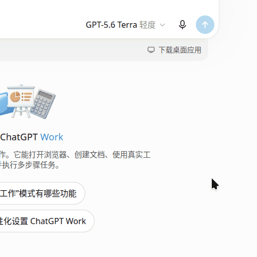
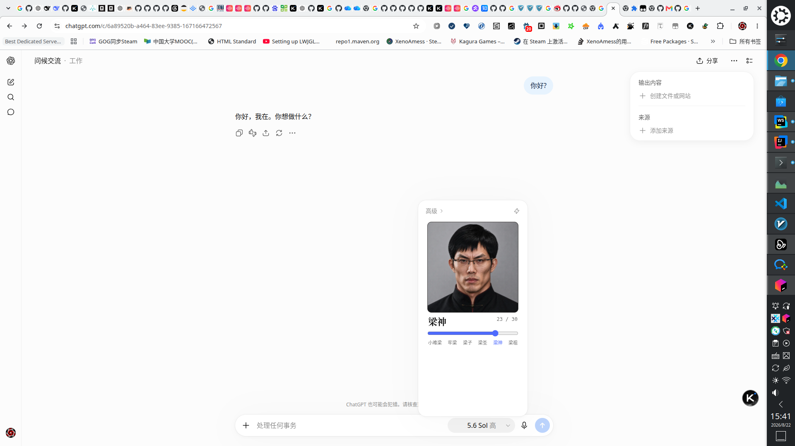

# 滑动变祖器 · ChatGPT 思考滑杆

**Liang Saint Slider for ChatGPT** — 一个浏览器扩展（MV3），把 [chatgpt.com](https://chatgpt.com) 的思考强度滑杆替换为 31 级「滑动变祖器」。拖动滑杆，人像会从「小难梁」一路变化到戴上帝冕的「梁祖」；底层仍然驱动 ChatGPT 原生滑杆，思考强度功能完全保留。

灵感与素材来自：

- [liang-intensity-calibrator](https://github.com/Lichtspektrum/liang-intensity-calibrator) — 原版「滑动变祖器」网页小玩具（31 级梁系强度校准器）
- [Liang-Saint-Slider](https://github.com/BruzWJ/Liang-Saint-Slider) — DeepSeek Harness 版选择器，本项目的映射语义与其一致

## 效果




点开输入框旁的「模型 · 思考强度」弹层（如 `5.6 Sol 高`），原生蓝色滑杆会被替换为：

- 随档位连续变化的梁系人像（31 张关键帧）
- 0–30 的梁系强度滑杆与 `NN / 30` 读数
- 六阶段标注：小难梁 / 牢梁 / 梁子 / 梁圣 / 梁神 / 梁祖

0–30 轨道按比例切分到 ChatGPT 原生滑杆的实际档位数（与 Liang-Saint-Slider 同一套映射：档位 i = `floor(pos·N/31)`，反向端点取 0/30、中间均分）。

## 安装

### 方式一：下载 Release（推荐，无需构建）

1. 到 [Releases](https://github.com/XenoAmess/Liang-Saint-Slider-For-Chatgpt-Website/releases) 下载最新的 `liang-saint-slider-extension-vX.X.X.zip`，解压；
2. 打开 `chrome://extensions`，右上角开启「开发者模式」；
3. 点「加载未打包的扩展程序」，选择解压出的文件夹；
4. 硬刷新（Ctrl+Shift+R）chatgpt.com，点开思考强度弹层即可看到变祖器。

### 方式二：从源码构建

```sh
git clone https://github.com/XenoAmess/Liang-Saint-Slider-For-Chatgpt-Website.git
cd Liang-Saint-Slider-For-Chatgpt-Website
npm run build:extension   # 生成 dist/extension/
```

然后按方式一的 2–4 步加载 `dist/extension/`。

> 说明：核心逻辑在单文件 `liang-saint-slider.user.js`（也是合法的用户脚本），扩展由 `dev/build-extension.mjs` 从它自动生成——版本号、CSS、逻辑同一事实来源；31 张帧直接打包进扩展，不联网、不受页面 CSP 约束。

## 工作原理

1. `MutationObserver` 等待思考强度弹层出现，在其中寻找原生滑杆（Radix 式 `[role="slider"]` 或 `input[type="range"]`）。
2. 在原生滑杆上方注入变祖器面板并隐藏原生滑杆本体；弹层其余部分（高级 ›、快速模式开关等）保持原样。
3. 拖动变祖器时按比例映射到原生档位，并通过**驱动策略瀑布**（ReactProps 直调 / 键盘事件@快捷键宿主 / 键盘@thumb / 指针@轨道，命中后记忆复用）驱动真实滑杆，ChatGPT 自身状态逻辑零改动；React 重渲染换节点后自动自愈（重新隐藏、面板重挂、惰性解析最新节点）。
4. 自检失败（原生滑杆不可驱动）时自动回滚还原，不会把功能藏没。
5. 扩展内打包全部帧素材，离线可用；用户脚本形态下则按 `FRAME_BASES` 多源回退加载。

ChatGPT 改版导致失效时，通常只需修改脚本顶部 `CONFIG` 里的选择器。

**控制台调试（任意控制台上下文直接执行，无需切换）**：

```js
document.dispatchEvent(new CustomEvent('liang-command', {detail:'dump'}))
```

支持命令：`dump`（导出弹层 DOM）/ `probe`（滑杆候选表）/ `testDrive`（实测真实滑杆吃哪种驱动事件，自动还原原值）/ `restore`（还原全部原生滑杆）。结果除控制台输出外还会弹出带「复制」按钮的页面浮层。

## 故障排查

1. **整页硬刷新（Ctrl+Shift+R）**。chatgpt.com 是单页应用，扩展安装/更新后已打开的标签页不会补注入。
2. **确认扩展已启用且有权访问本站**：`chrome://extensions` 里本扩展卡片开关打开、开发者模式开着；详情页「网站访问」允许 chatgpt.com。
3. **看注入信标**：刷新后页面右下角应闪现「滑动变祖器 vX.X.X 已注入」徽章，控制台（F12）过滤 `滑动变祖器` 应看到 `已注入` 日志。
4. **徽章有但滑杆没变** → ChatGPT 的实际 DOM 与选择器不匹配。控制台执行上面那条 `liang-command` 命令（`dump` / `testDrive`），把浮层内容复制发给作者即可校准。

## 本地开发

```sh
npm run dev
# 打开 http://localhost:8787/dev/mock.html
```

`dev/mock.html` 模拟了 ChatGPT 弹层结构（Radix 风格 `role="slider"` 变体 + `input[type=range]` 变体 + 苛刻弹层变体 + 纯指针滑杆变体 + React 换节点回放），无需登录 ChatGPT 即可离线验证脚本逻辑；`?autotest=1` 跑回归断言并把结果写进 `document.title`。

## Chrome Web Store 发布

```sh
npm run package:store
```

需要本机安装 Chrome、`zip` 和 `unzip`（可用 `CHROME_BIN` 指定浏览器）。命令会构建扩展，并在 `dist/chrome-web-store/` 生成根目录含 `manifest.json` 的上传 ZIP、1280×800 真实效果截图、440×280 宣传图、图标和填写文案。商店图片和文案在后台分别上传，不放进扩展 ZIP。

完整字段、隐私披露和审核测试说明见 [上架材料](store/LISTING.zh-CN.md)，数据处理方式见 [隐私政策](PRIVACY.md)。是否已发布以 Chrome Web Store 后台审核状态为准。

本次提交的项目 ID、审核后台入口与发布设置见 [Chrome Web Store 提交记录](store/SUBMISSION.md)。

## 素材与致谢

本项目**源代码**以 [MIT 协议](LICENSE) 发布。

`frames/` 目录下的 31 张人像帧来自 [liang-intensity-calibrator](https://github.com/Lichtspektrum/liang-intensity-calibrator) 项目的 `public/frames`，**素材不随 MIT 协议共享**，仅用于趣味演示；复用或二次发布前，请确认你拥有相关肖像与素材的使用权（见原项目 README）。

## License

MIT（仅代码；人像素材权利归原作者所有，见上节）。
